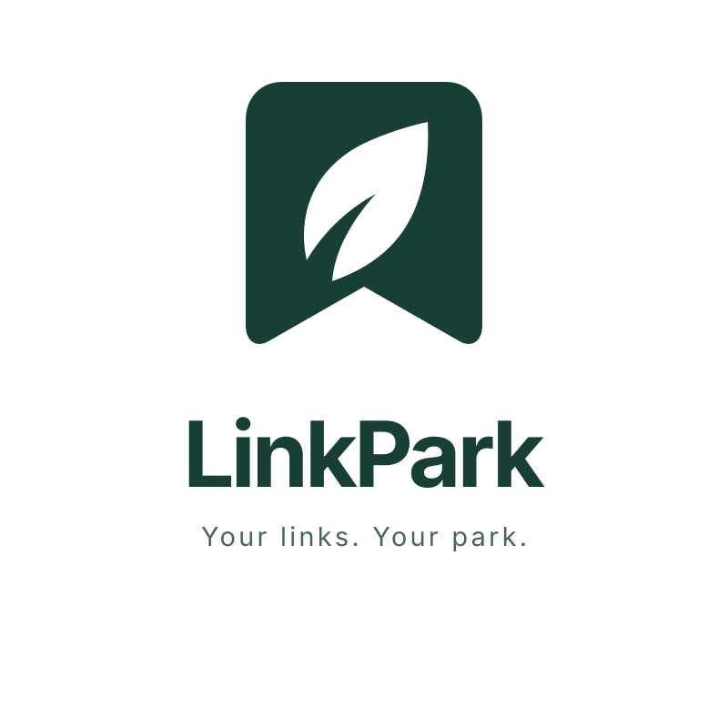

<p align="center">
  
</p>

<h1 align="center">LinkPark</h1>

<p align="center">
  自托管的云端书签。<br>
  一个浏览器扩展，一台你自己的服务器。
</p>

LinkPark 把日常收藏留在浏览器里，把数据留在你自己的机器上。扩展负责搜索、整理和暂存；Go 服务用 SQLite 保存书签，多台设备按版本号增量同步。离线时改动先记在本地，连上之后自动补齐。

## 功能

- **随手收藏。** 右键菜单把当前页面加入 LinkPark。已收藏的地址不会重复添加。
- **找得到。** 点击工具栏图标打开书签列表：搜索、按标签筛选，并按默认顺序、最近添加、访问频率或名称排序。上次的搜索、筛选和滚动位置会留下来。
- **排得住。** 全部书签共用一条手动顺序。换一组标签查看时，相对位置保持不变；默认排序下可以拖拽调整。
- **标签。** 可以固定、排序和重命名。改成已有的名字即合并。没有任何标签的书签归入「未分类」。
- **暂存窗口。** 把当前窗口的标签页收成一组，之后整组打开，或逐条收藏、移除。
- **一次导入。** 从浏览器书签或导出的 HTML 导入。路径上的每一级文件夹成为一个标签。
- **同步状态看得到。** 工具栏角标是待同步条数；`!` 表示失败，`?` 表示还没配置。悬停查看详情，右键打开设置或立即同步。

## 快速开始

### 服务端

```bash
cp .env.example .env   # 设置 LINKPARK_TOKEN（至少 16 个字符）
docker compose up -d
```

数据写在 `./data/linkpark.db`。前面加一层 HTTPS 反向代理（Caddy、Nginx 等）再对浏览器开放。环境变量、镜像发布和从源码运行见 [部署](design/deployment.md)。

### 扩展

```bash
cd extension
npm install
npm run build          # 产物在 extension/dist
```

打开 `chrome://extensions`，启用「开发者模式」，选择「加载已解压的扩展程序」，指向 `extension/dist`。

也可以下载 GitHub Actions 的 `linkpark-extension.zip`（推送 `v*` tag 时会附到 Release）。

安装后会打开引导页：填写服务端地址和 Token，再选择是否导入浏览器书签。


## 许可证

[MIT](LICENSE)
