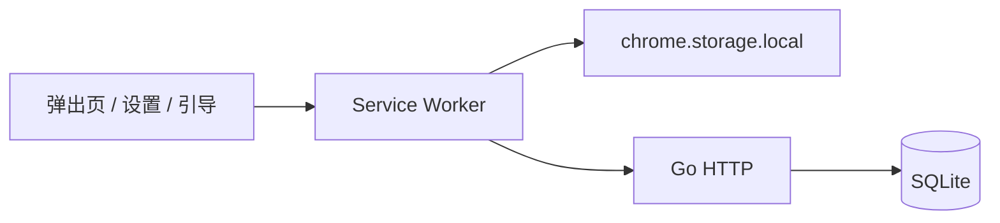

# 架构

LinkPark 是单用户系统：一台服务、一个共享 Token，没有账号体系。扩展是唯一的客户端，服务是唯一的数据源。多台浏览器各自保留一份缓存，提交修改后再按版本号把服务端的变化拉回来。



界面不直接请求服务端。弹出页、设置页和引导页通过 `chrome.runtime` 消息交给后台的 Service Worker。Worker 把操作写入本地缓存和 outbox，再由同步引擎推到 `/api/v1`。读界面时用的是「服务端缓存 + 尚未确认的本地操作」，所以断网时列表仍然可改。

## 目录

```
server/
  cmd/linkpark/          进程入口、健康检查、定时清理幂等键
  internal/api/          路由、限额、CORS、请求日志
  internal/auth/         Bearer Token
  internal/model/        线上传输的类型
  internal/store/        SQLite 读写与迁移
  migrations/            按文件名顺序执行的 SQL
extension/
  src/background/        右键菜单、同步调度、工具栏角标
  src/popup/             书签列表、标签栏、暂存
  src/options/           服务端地址、标签管理、导入
  src/onboarding/        首次填写地址和 Token
  src/lib/               操作、同步、排序、导入、图标
```

扩展使用 Manifest V3。界面是 React，样式是 Tailwind，打包用 Vite（`@crxjs/vite-plugin`）。服务端是 Go，SQLite 驱动是 `modernc.org/sqlite`（纯 Go，镜像里不需要 CGO）。

## 服务端

进程启动时要求 `LINKPARK_TOKEN` 至少 16 个字符，打开数据库，嵌入的迁移按文件名顺序执行。HTTP 服务在收到中断信号后退出。

`/healthz` 不鉴权，供容器健康检查使用。镜像里没有 shell 和 curl，检查命令是 `/linkpark healthcheck`，它请求本机的 `/healthz`。

`/api/` 之下全部经过 Bearer 中间件。比较前两边都会做 SHA-256，再用常量时间比较，避免按 Token 内容提前返回。失败时返回 401 和 `WWW-Authenticate`。

CORS 只放行 `chrome-extension://` 开头的来源。扩展拿到主机权限后浏览器会跳过 CORS；这条规则覆盖还没授权主机权限的情况。

SQLite 以 WAL 打开，外键开启，`busy_timeout` 5 秒，`synchronous=NORMAL`。所有改数据的调用都在一个事务里把 `meta.version` 加一，客户端用这个整数做增量拉取。

## 扩展里的状态

`chrome.storage.local` 分成几块：

| 键 | 内容 |
| --- | --- |
| `settings` | 服务端地址和 Token |
| `cache` | 最近一次拉取的书签、暂存、标签元数据，以及当时的 `version` |
| `outbox` | 已在本地生效、尚未被服务端确认的操作 |
| `failed` | 服务端拒绝、不会自动重试的批次 |
| `syncState` | 同步状态、退避次数、上次成功时间和错误 |
| `icon` | 用户设置的工具栏图标 |

弹出页看到的列表是 `buildState(cache, outbox)`：先铺开缓存，再按顺序把 outbox 里的操作叠上去。服务端确认之后，这些操作从 outbox 删除，同一变化改由拉取结果体现。

权限：`contextMenus`、`storage`、`alarms`、`bookmarks`、`favicon`、`activeTab`、`unlimitedStorage`。读取浏览历史（访问频率排序）和标签页（暂存窗口）是可选权限，第一次用到时再申请。主机权限也是可选的，配好服务端地址后再向该来源申请。

同步协议见 [同步](sync.md)，字段和排序规则见 [数据模型](model.md)，HTTP 形状见 [API](api.md)。
